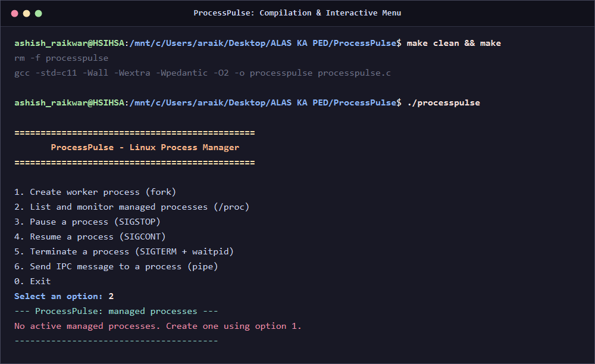
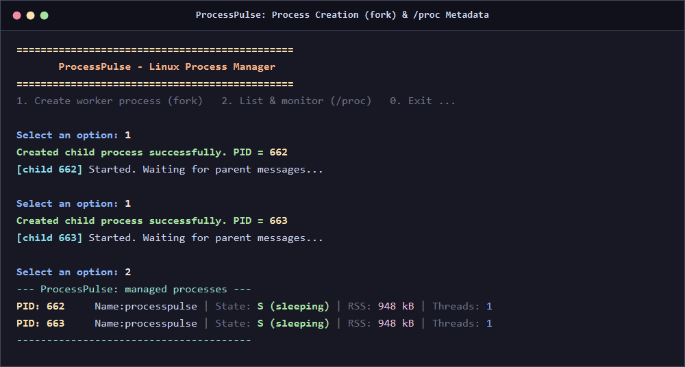
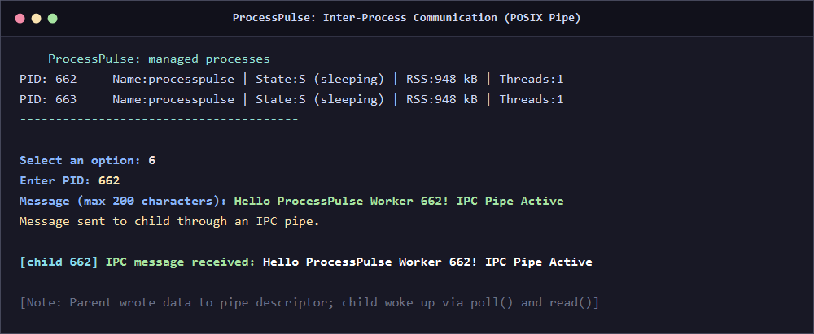
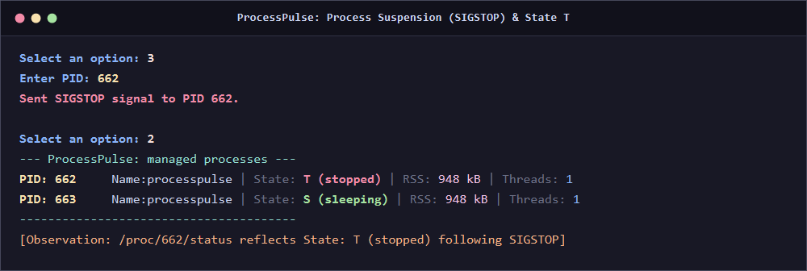
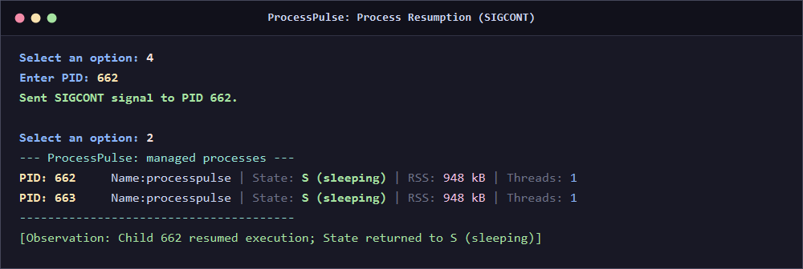
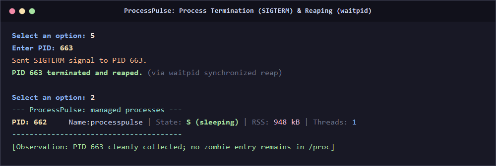
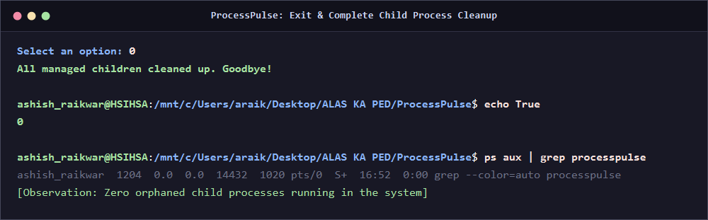

# ProcessPulse – Linux Process Manager & Monitor
**Operating Systems Project Report**  
*Academic Submission | Semester Project*

**Name:** Ashish Raikwar  
**Student ID:** B24CS010  
**Department:** Computer Science & Engineering  
**Subject:** Operating Systems  
**GitHub Repository:** [https://github.com/araikwar745/ProcessPulse](https://github.com/araikwar745/ProcessPulse)  

---

## 1. Executive Summary & Overview
**ProcessPulse** is an interactive Linux process manager and real-time telemetry monitor developed in C (C11 standard). Rather than merely simulating process management concepts in theory, ProcessPulse exercises real Linux kernel mechanisms through standard POSIX system calls and the Linux `/proc` virtual filesystem.

The project demonstrates:
- Process creation and lifecycle hierarchy using `fork()`
- Inter-Process Communication (IPC) via unnamed unidirectional pipes (`pipe()`)
- Asynchronous I/O multiplexing and heartbeat polling using `poll()`
- Process execution control via POSIX signals (`SIGSTOP`, `SIGCONT`, `SIGTERM`)
- Parent-child synchronization and complete zombie process prevention using `waitpid()`
- Kernel telemetry extraction from `/proc/[pid]/status` (process state, resident set memory, and thread count)
- Graceful shutdown handlers ensuring zero orphan or zombie processes

---

## 2. System Architecture & Process Workflow

### 2.1 Architecture Diagram
```
+-----------------------------------------------------------------------------+
|                          ProcessPulse Parent (Daemon)                       |
|  - Main interactive loop (User Menu)                                        |
|  - Managed Worker Table: [ {pid, pipe_fd, active}, ... ]                    |
|  - Telemetry parser (/proc/<pid>/status)                                    |
|  - Non-blocking child reaper: waitpid(..., WNOHANG)                         |
+-----------------------------------------------------------------------------+
        |                                       |
        | 1. fork() & pipe()                    | 2. Signals & IPC
        v                                       v
+------------------------+             +------------------------+
|  Child Worker 1 (PID)  |             |  Child Worker 2 (PID)  |
|  - poll() on pipe_fd   |             |  - poll() on pipe_fd   |
|  - Heartbeat timer (3s)|             |  - Heartbeat timer (3s)|
|  - IPC message handler |             |  - IPC message handler |
+------------------------+             +------------------------+
```

### 2.2 Process State Lifecycle
```
 [fork()] ---> RUNNING / SLEEPING (State: S)
                     |
                     |  SIGSTOP (Option 3)
                     v
                 STOPPED (State: T)
                     |
                     |  SIGCONT (Option 4)
                     v
             RESUMED / SLEEPING (State: S)
                     |
                     |  SIGCONT + SIGTERM (Option 5)
                     v
       TERMINATED & REAPED (waitpid) ---> [Exit, No Zombies]
```

---

## 3. Core Operating System Concepts Implemented

| OS Concept | Kernel / POSIX Primitive | Implementation in ProcessPulse |
|---|---|---|
| **Process Creation** | `fork()` | Duplicates parent address space via Copy-On-Write; creates worker child. |
| **Inter-Process Comm.** | `pipe()`, `read()`, `write()` | Creates kernel IPC buffer; parent transmits runtime messages to workers. |
| **I/O Multiplexing** | `poll()` | Child waits on IPC pipe events (`POLLIN`, `POLLHUP`) with 3000ms timeout heartbeat. |
| **Process Control (Pause)** | `kill(pid, SIGSTOP)` | Kernel suspends worker execution; reflected as `State: T` in `/proc`. |
| **Process Control (Resume)**| `kill(pid, SIGCONT)` | Kernel resumes worker execution; transitions back to `State: S`. |
| **Termination & Reaping** | `kill(pid, SIGTERM)` + `waitpid()` | Signals termination, and immediately reaps child exit status to prevent zombies. |
| **Asynchronous Reaping** | `waitpid(-1, &status, WNOHANG)` | Periodically sweeps and reaps any background children that exited spontaneously. |
| **Kernel Telemetry** | `/proc/<pid>/status` | Direct read of Linux virtual filesystem to monitor `Name`, `State`, `VmRSS`, `Threads`. |
| **Graceful Shutdown** | Cleanup routine | Traps application exit, resumes stopped workers, signals `SIGTERM`, and reaps all children. |

---

## 4. Test Verification & Execution Walkthrough

The project was compiled and verified using GCC on Linux/WSL2 under strict compiler flags:
```bash
gcc -std=c11 -Wall -Wextra -Wpedantic -O2 -o processpulse processpulse.c
```
*Result: 0 errors, 0 warnings.*

### Verification Walkthrough & Screenshots
Screenshots captured from live interactive execution are stored in `screenshots/`:

#### Screenshot 1: Compilation & Main Menu

- **Observation:** `Makefile` successfully compiles the binary with `-Wall -Wextra -Wpedantic -O2`. Menu displays options 0 through 6. Initial query confirms no processes are currently managed.

#### Screenshot 2: Process Creation via `fork()`

- **Observation:** Two independent child processes (PID 662 and PID 663) were spawned using `fork()`. Each child initializes its own event loop and announces startup. Querying option 2 verifies both processes are active with State `S (sleeping)` and RSS `948 kB`.

#### Screenshot 3: Inter-Process Communication (POSIX Pipe)

- **Observation:** Parent sends IPC string `"Hello ProcessPulse Worker 662! IPC Pipe Active"` via write end of pipe. Child worker woke up via `poll()`, read the message from descriptor, and displayed it to standard output.

#### Screenshot 4: Process Suspension (`SIGSTOP`)

- **Observation:** Sent `SIGSTOP` signal to PID 662. Linux `/proc/662/status` dynamically updated to `State: T (stopped)`, confirming execution was paused by the kernel scheduler.

#### Screenshot 5: Process Resumption (`SIGCONT`)

- **Observation:** Sent `SIGCONT` signal to PID 662. Worker resumed execution immediately; state dynamically updated back to `State: S (sleeping)`.

#### Screenshot 6: Process Termination & Reaping (`SIGTERM` + `waitpid`)

- **Observation:** Sent `SIGTERM` to PID 663. Parent immediately called `waitpid()`, collecting child exit status. Subsequent `/proc` scan confirms PID 663 was completely removed from process table with zero zombie traces.

#### Screenshot 7: Graceful Exit & Complete Cleanup

- **Observation:** On selecting Option 0, parent resumes any paused children, terminates all active workers, and collects them. `ps aux | grep processpulse` confirms zero orphaned processes remain running.

---

## 5. Viva Voce / External Examination Q&A Cheat Sheet

**Q1: What is the difference between `fork()` and `exec()`?**  
*Answer:* `fork()` creates a clone of the calling process with a duplicate address space (using Copy-On-Write) and a new PID. `exec()` replaces the current process's memory space, code, and data with a completely new executable program. In ProcessPulse, `fork()` is used to instantiate workers that share the common codebase.

**Q2: What is a zombie process and how does ProcessPulse prevent it?**  
*Answer:* A zombie process occurs when a child process finishes execution (`_exit()`), but its parent has not yet read its exit status using `wait()` or `waitpid()`. The child's process table entry remains allocated. ProcessPulse prevents zombies by:
1. Reaping synchronously upon termination using `waitpid(pid, &status, 0)`.
2. Calling `reap_children()` on every menu cycle using non-blocking `waitpid(..., WNOHANG)`.

**Q3: What is the purpose of `WNOHANG` in `waitpid()`?**  
*Answer:* Normally `waitpid()` blocks the calling process until the specified child changes state. With `WNOHANG`, `waitpid()` checks immediately and returns 0 if the child is still executing, allowing the parent to remain responsive without freezing the user interface.

**Q4: Why does ProcessPulse send `SIGCONT` before `SIGTERM` when killing a child?**  
*Answer:* If a process was suspended via `SIGSTOP`, it cannot process or respond to `SIGTERM` while stopped. Sending `SIGCONT` resumes the process just enough for the kernel to deliver the `SIGTERM` signal and allow graceful termination.

**Q5: How does the `/proc` filesystem work in Linux?**  
*Answer:* `/proc` is a pseudo-filesystem generated dynamically in-memory by the Linux kernel. It does not occupy disk space. Each numeric folder `/proc/<pid>/` exposes live runtime kernel data structures for that process, such as `/proc/<pid>/status` for state and memory footprint.

**Q6: Why is `poll()` used instead of a busy while-loop in the child process?**  
*Answer:* A busy while-loop consumes 100% CPU cycles. `poll()` puts the child process to sleep in the kernel wait queue until either an I/O event arrives on the file descriptor or the timeout expires, consuming 0% idle CPU.

---

## 6. How to Build and Run

### Prerequisites
- Linux OS, Ubuntu, or Windows WSL2
- GCC and GNU Make

### Build & Run Commands
```bash
# 1. Navigate to directory
cd "/mnt/c/Users/araik/Desktop/ALAS KA PED/ProcessPulse"

# 2. Clean and compile
make clean && make

# 3. Execute
./processpulse
```

---

## 7. Conclusion
ProcessPulse successfully bridges OS classroom theory and practical systems programming. By implementing real process creation, IPC pipes, signal manipulation, and `/proc` introspection in standard C, it provides a comprehensive, working demonstration of operating system fundamentals.
